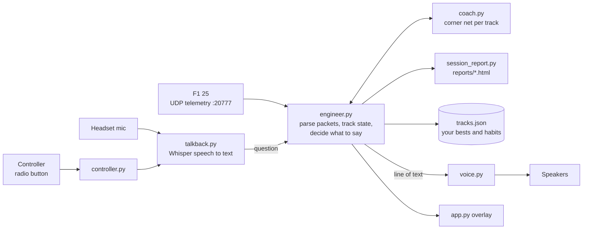
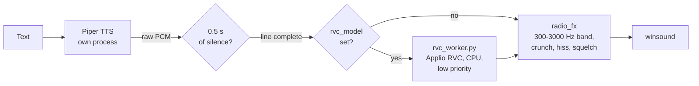
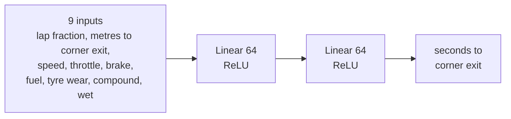

# F1 25 Race Engineer

A lightweight race engineer for EA SPORTS F1 25 on PC. It talks to you over the radio like a real
race engineer: setup advice in practice, plus gaps, fuel, tyres, pit window and safety car calls in the race.

- **Voice:** a natural British male voice ([Piper](https://github.com/OHF-Voice/piper1-gpl), offline) with a team-radio effect. Falls back to the Windows voice.
- **Overlay:** a small radio box that pops up over the game while the engineer talks.
- **Starts with the game:** Steam launch option runs the engineer alongside F1 25 and stops it when the game closes. Nothing runs otherwise.
- **Optional radio button:** press a controller combo to ask for an update at any time.
- **Real-world data:** per-track briefings built from real F1 races with [FastF1](https://github.com/theOehrly/Fast-F1).
- **No extra packages:** the engineer itself uses only the Python standard library.

## Is it safe? (anti-cheat)

Yes. The engineer never touches the game. It reads only:
- the game's **official UDP telemetry output**, a feature EA built in for dashboards and sim tools;
- controller buttons through the normal Windows APIs (XInput / winmm), read-only, the same way any launcher does.

No injection, no memory reading, no file changes to the game.

## Setup

1. Run `install.bat`. It installs Python if needed, and prints the Steam launch option to paste.
2. In F1 25, open **Settings → Telemetry Settings** and set:
   - UDP Telemetry: **On**
   - UDP Broadcast Mode: **Off**
   - UDP IP Address: **127.0.0.1**
   - UDP Port: **20777**
   - UDP Send Rate: **20Hz**
   - UDP Format: **2025**
3. Set display mode to **Borderless** or **Windowed**. The overlay can't draw over exclusive Fullscreen; the voice works in any mode.

Drag the overlay to move it. Right-click it to quit. To remove the engineer, run `uninstall.bat`.

### Voice

`install.bat` installs Piper and two voices: `en_GB-northern_english_male-medium` (default) and
`en_GB-alan-medium`. To switch, set `"voice"` in `config.json` to either name,
or to `"windows"` for the built-in Windows voice. Then restart the engineer.
Preview a voice: `python voice.py "Box box, box box."`

Optional custom voice: if you trained an RVC model in [Applio](https://github.com/IAHispano/Applio),
set `"rvc_model"` in `config.json` to its `.pth` (in `<Applio>/logs/<name>/`). The engineer keeps it
loaded via `rvc_worker.py` under Applio's own Python and re-voices each Piper line on the CPU at low
priority, so it never takes frames from the game. It takes about 20 s to load at start and, with F1 25
running, 6 to 7 s per line on the CPU (2 to 4 s on the GPU, but then the game drops to a few fps while each
line converts). That is too late for race calls, so it is off by default. If it fails, lines play in the Piper voice.

Piper is GPL-3.0 and runs as a separate program; it is not bundled with or linked into this MIT code.

### Optional radio button

Run `Bind Radio Button.bat` and hold the buttons you want for 2 seconds. Pick buttons that do
nothing in F1 25. Works with Xbox pads, and with DualSense either through Steam Input or as a
plain HID controller. Press the combo during a session and the engineer reads out your current state.
Remove it with `python app.py --unbind`.

**Talk-back (optional).** With `pip install openai-whisper sounddevice`, hold the radio button, ask a
question into your headset mic, and let go: "how are the tyres?", "what's the gap?", "when do we box?",
"fuel?", "battery?", "best lap?", "weather?". Speech to text runs locally with Whisper,
on the CPU. A quick tap still gives the usual update.

## What it tells you

It only advises things you can change in F1 25: the **setup menu** in the garage, and **brake bias,
differential and ERS mode** on the MFD. Everything else is driving technique.

On track it only talks about what you can change while driving: brake bias, diff and ERS on
the MFD, and technique. Setup menu advice waits until you're in the garage or pause the game.

**Practice and time trial** (time trial is the quickest way to test it):
- a short briefing: downforce and wing range, your best here, and the corner you keep getting wrong;
- after every clean lap: lap time, then the corner where you lost the most against your best lap and why
  (braked early, slow at the apex, late on the power), plus the corner where you gained;
- lock-ups and wheelspin by corner, with the MFD fix (bias, diff) or the technique fix;
- in the garage or pause menu: setup advice from tyre and brake temps (wings, diff, pressures);
- each setup change, and whether it made you faster.

**It learns you.** Per track, `tracks.json` keeps your all-time best lap corner by corner and how
often you brake early, lock up, spin the rears or get on the power late at each corner. A new
session coaches you against your all-time best from lap 1 and opens with your weakest corner.
Repeated mistakes get called: "that's 3 laps in a row".

**Live corner coach (optional, needs PyTorch).** A small neural net per track learns your clean laps
on your PC. After 5 laps of data it trains in the background on the CPU and
retrains after every clean lap. At each apex it predicts your corner exit time from your speed, pedals
and the car's state (fuel, tyre wear, compound, wet), compares it with what you usually do from that corner
entry in that state, and calls a slow corner while you are still in it: "Turn 7, losing 0.3."
So heavy fuel or old tyres don't get blamed on you. Models are kept in `models/` (see [Trained weights](#trained-weights)).

**Theoretical best.** Your best lap plus your best time in every corner: "Theoretical best 1 21.9, time
left in turn 1 and turn 11."

**Session report.** After every lap the engineer rewrites a page in `reports/` for that session: lap
times, time lost or gained per corner against your best lap, theoretical best, habits, and tyre deg in a race.
Open it in a browser between stints.

The coach, talk-back and RVC voice all run on the CPU, even with a GPU build of PyTorch: GPU compute
while F1 25 renders drops the game to a few fps. `pip install torch` is enough. To try the GPU anyway,
set `"gpu": true` in `config.json`.

**Race:**
- the real-race strategy for that track, scaled to your race length (pit window lap), replaced by your own once it has 4 laps of your tyre deg: "Your tyres are losing 0.12 a lap. Best stop around lap 23.";
- position and gaps every lap, plus DRS range;
- fuel plus or minus, battery, and tyre wear;
- live "lift and coast into turn X" before the two biggest stops when fuel, brakes or tyres need saving;
- diff and bias changes on the MFD when tyres overheat;
- safety car (including a cheap pit stop call), penalties, front wing damage, weather, and the last lap.

Corner numbers are the official ones, placed using real F1 track data.

## How it works



`app.py` listens on UDP, hands every packet to `engineer.py`, and shows each radio line in the overlay.
The engineer is plain Python; PyTorch, Whisper and Piper are optional add-ons it uses when installed.

### Voice pipeline



Piper and the RVC worker stay loaded for the whole session, so a line costs only synthesis time. If the
RVC worker fails, the line plays in the Piper voice.

### GPU or CPU

Everything that uses PyTorch runs on the CPU by default. F1 25 keeps the GPU busy, and on Windows a
compute job on the same AMD GPU holds it until it finishes, so the game drops to a few fps while it runs.
Measured on an RX 9060 XT with F1 25 running:

| Job | CPU | GPU |
|-----|-----|-----|
| RVC re-voicing, one 3.5 s line | 6 to 7 s, no fps loss | 2 to 4 s, game drops to a few fps |
| Corner net training | under a second | under a second, a stutter |
| Whisper `base.en`, one question | about a second | faster, a stutter |

Set `"gpu": true` in `config.json` to run all three on the GPU anyway. Torch uses at most 4 CPU threads.

## Trained weights

`models/6.pt` is a live corner coach net trained on my own laps of Montreal (10 clean laps, 7118
samples). Files are named by the F1 25 track id (see `TRACKS` in `engineer.py`). Keep it in your
`models/` to get live corner calls at Montreal from lap 1; the coach keeps retraining it on your laps.
Nets for other tracks are trained on your PC and are not committed.

Each file is a `torch.save` dict:

| Key | What |
|-----|------|
| `net` | `state_dict` of the net below |
| `x` | training inputs, one row per corner sample, 9 features |
| `y` | targets: seconds from that sample to the corner exit |
| `laps` | clean laps the data came from |



```python
import torch, coach
saved = torch.load('models/6.pt', weights_only=True)
net = coach.build(); net.load_state_dict(saved['net']); net.eval()
print(net(torch.tensor([coach.features(0.12, 150, 210, 0.4, 0.0, (0.5, 0.2, 0.5, 0))])).item())
```

The voice model of the RVC option is not published.

## Race simulator

Test the race calls without driving a race. `simulate.py` drives a fake race through the engineer in
seconds: tyre deg, fuel burn, lap-time noise, mistakes, a safety car, and a driver who boxes when told.
Every radio call is logged, and the stop is graded against the best stop for the true deg.

```
python simulate.py                                       18 laps at Monza, safety car on lap 11
python simulate.py --laps 30 --deg 0.15 --sc 0 --seed 4  other race, other luck
python simulate.py --ask "8:when should we pit"          a driver question on lap 8
python simulate.py --live --speed 10                     into the running engineer: hear it, ask on the radio button
```

Logs and report pages go to `reports/sim/`. The running engineer logs its own calls, and what
talk-back heard, to `engineer.log`.

## Real-world track data

`track_data.json` is built from real F1 races. To rebuild it (for example for a new season):

```
pip install fastf1
python -m fastf1 auth f1tv --authenticate --method browser
python build_track_data.py 2025
```

F1's timing data now needs a Formula 1 account sign-in. Without `track_data.json`, the engineer
still works; it just skips the real-world briefing.

## Files

| File | What |
|------|------|
| `app.py` | Entry point: overlay, telemetry listener, radio button |
| `engineer.py` | Packet parsing (F1 25 UDP format 2025) and all the advice |
| `voice.py` | Piper voice + team-radio effect, Windows voice fallback, optional RVC re-voicing |
| `rvc_worker.py` | Keeps an Applio RVC model loaded for `voice.py` (runs under Applio's Python) |
| `coach.py` | Optional live corner predictor (PyTorch) |
| `talkback.py` | Optional talk-back: push to talk, Whisper speech to text |
| `session_report.py` | Session report pages in `reports/` |
| `simulate.py` | Race simulator with logging |
| `fakegame.py` | Fake F1 25 packets for the tests and the simulator |
| `controller.py` | Optional read-only controller button reader |
| `build_track_data.py` | Builds `track_data.json` from FastF1 |
| `tests/test_engineer.py` | Feeds fake packets through the engineer: `python tests/test_engineer.py` |

`tracks.json` (your own bests) and `config.json` (overlay position, radio button, voice, `gpu`) are created on your PC and are not committed.

## License

[MIT](LICENSE)

## Disclaimer

Unofficial fan project. Not affiliated with or endorsed by Formula 1, the FIA, EA or Codemasters.
F1 is a trademark of Formula One Licensing B.V. Real-world timing data comes through FastF1;
follow F1's terms for that data.
